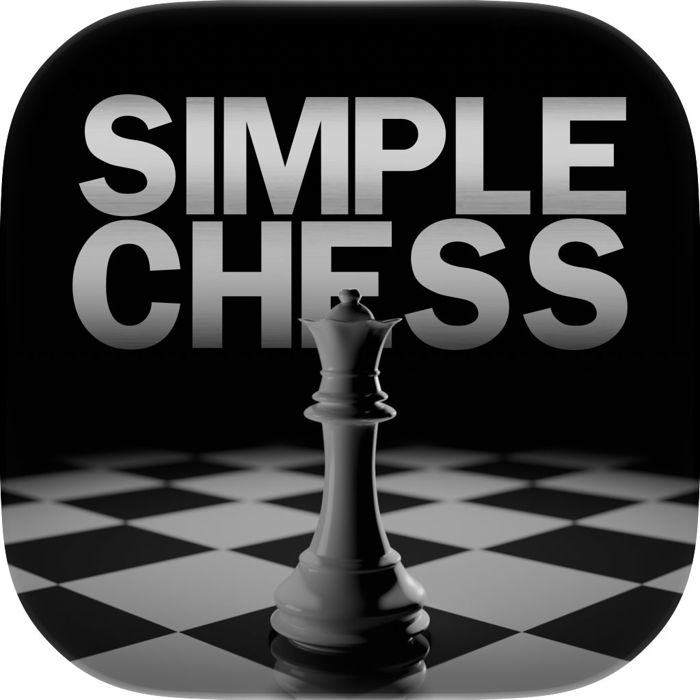

<p align="center">
  
</p>

<h1 align="center">SimpleChess</h1>

<p align="center">From an HCE that relied on simple chess principles came the NNUE that rose above them.</p>


SimpleChess pairs a modern, heavily-tuned alpha-beta search with a from-scratch
NNUE evaluation trained entirely on the engine's own self-play. Board representation
and legal move generation come from a vendored, header-only move-generation
library. The engine has hand-tuned SIMD paths for both Apple Silicon (NEON) and
x86-64 (AVX2), and builds and runs anywhere with a C++20 compiler.

## Strength

| Version | CCRL Blitz | CCRL 40/15 |
|---|---|---|
| 3.6.0 1CPU | Not yet tested | Not yet tested |
| 3.5.0 1CPU | **3562** (±16, #84, 959 games) | **3483** (±19, #90, 513 games) |
| 3.4 or earlier | Never tested | Never tested |

<sub>CCRL ratings as of 2026-10-27.</sub>

## Features

- **Evaluation** — a custom NNUE: a HalfKAv2_hm input (king-bucketed and
  mirrored) extended with threat and pawn-pair features, a 512-wide accumulator,
  and int8 SIMD inference (NEON on Apple Silicon, AVX2 on x86-64).
- **Endgame tablebases** — Syzygy WDL probing (via Fathom): point `SyzygyPath` at
  your 3-4-5 or 6-man tables.
- **Search** — iterative-deepening alpha-beta with aspiration windows, null-move
  pruning, late-move reductions, SEE-based pruning, a transposition table,
  killer / history / continuation move ordering, correction history (pawn-structure,
  weighted by an evaluation-tension signal), and lazy-SMP multithreading.
- **Chess960 / FRC and DFRC** — set `UCI_Chess960` (GUIs and lichess-bot do it for
  you): castling is spoken king-to-rook (`e1h1`), X-FEN and Shredder-FEN castling
  fields are both accepted, and asymmetric (DFRC) back ranks need nothing extra.
- **UCI** — speaks the UCI protocol; drop it into any UCI GUI (Cute Chess,
  BanksiaGUI, En Croissant, Arena). Debug conveniences: `d` (board, FEN, key) and
  `perft <depth>` (bulk-counted: each root move's count, then the total). Optional win/draw/loss
  chances in the info lines (`UCI_ShowWDL`).
- Optional Polyglot opening book support — off by default; no book ships, bring your own.

## Build

The Makefile is the primary build path — no CMake required. Requires a C++20
compiler (Apple clang works out of the box).

```sh
make            # optimized native build   ->  ./simplechess
make debug      # -O0 -g with ASan/UBSan and assertions
make clean
```

For the fastest (shipping) binary, use the profile-guided build:

```sh
make profile-build PGO_NET=nets/SCNNUEv3-2026-10-15.scn5
```

The release build uses `-O3 -flto -mcpu=native`; retarget the architecture with,
e.g., `make ARCH="-mcpu=apple-m2"` or `make ARCH="-march=x86-64-v3"`. On x86-64 hosts
the Makefile (and CMake) select `-march=native` automatically; for a binary that runs on
any AVX2 machine (Haswell or newer) use `make ARCH="-march=x86-64-v3"`.
`profile-build` additionally needs Python 3 with
[python-chess](https://pypi.org/project/chess/) (`pip install chess`) for its
training workload. A `CMakeLists.txt` is provided for IDE / CMake users.
`make EMBED_NET=nets/SCNNUEv3-2026-10-15.scn5` bakes the network into the executable
for a single-file deployment; a newer net beside the binary still takes precedence.

**Android (arm64).** The repository's GitHub Actions workflow
(`.github/workflows/android.yml`) cross-compiles a fully static build for 64-bit
Android phones — for DroidFish or any other UCI front-end — on every release tag and
on demand. Open the *Android build* run under the Actions tab and download
`simplechess-<version>-android-arm64.tar.gz` (or `-arm64-generic` for SoCs older
than about 2018, which lack the Arm dot-product extension). The network is embedded
in that binary — nothing else needs copying; the archive adds only install notes.

## Run

```sh
./simplechess
```

```
uci
position startpos
go depth 12
```

The network is discovered automatically at startup: the engine loads the newest
`SCNNUEv3-<YYYY-MM-DD>.scn5` found next to the binary or under `nets/` — the
current net ships in the repo, so the engine runs out of the box. There is no
fallback evaluation: if no network can be loaded the engine exits with an error.
Point the `EvalFile` option at another file to use a different network.

## UCI options

| Option | Default | Meaning |
|---|---|---|
| `Hash` | 4096 | transposition-table size, in MB |
| `Threads` | 8 | search threads (lazy SMP) |
| `Move Overhead` | 30 | ms reserved for GUI / network lag |
| `Ponder` | false | think on the opponent's clock |
| `MultiPV` | 1 | principal variations to report, best first (analysis; 1 = normal play) |
| `UCI_ShowWDL` | false | add `wdl W D L` (win/draw/loss chances per mille for the side to move) to every scored `info` line |
| `NormalizeScore` | true | report `cp` normalized so that 100 cp is a 50% win chance at the position's material; false = the raw search score |
| `UCI_Chess960` | false | Chess960 / FRC / DFRC: castling moves are sent and received king-to-rook (`e1h1`); FENs may carry X-FEN (`KQkq`) or Shredder (`HAha`) castling fields |
| `OwnBook` | false | opt in to a Polyglot book (none ships) |
| `Book File` | *(none)* | path to a Polyglot book, if you supply one |
| `EvalFile` | *(newest `SCNNUEv3-<date>.scn5`)* | network file to load |
| `RootNoise` | 0 | root-move score jitter (cp) for varied play |
| `SyzygyPath` | *(none)* | directory of Syzygy WDL tables (`*.rtbw`); probing is off until set |
| `SyzygyProbeDepth` | 1 | minimum remaining depth for an interior probe |
| `SyzygyProbeLimit` | 7 | probe only with this many pieces or fewer |
| `Syzygy50MoveRule` | true | treat cursed wins / blessed losses as draws |

**Score and win/draw/loss.** The reported `cp` is normalized by default: 100 cp means the side to move
wins half the time at the material on the board. The raw search score at which that happens falls from
about 5.8 pawns in bare endgames to 1.5 pawns with a full board, so normalized scores read smaller than
raw ones, the more so with less material; set `NormalizeScore` to false for the raw score. With
`UCI_ShowWDL` on, each scored `info` line also carries the side to move's chances in per mille, e.g.
`score cp 36 wdl 335 477 188`. Both come from a logistic model in the raw score whose centre and width
depend on the material, fitted on the engine's own depth-9 self-play with the shipped network, so with
another `EvalFile` the numbers are not calibrated. Mates and tablebase results read `1000 0 0` /
`0 0 1000` and keep their usual score.

## The network

`nets/SCNNUEv3-2026-10-15.scn5` is the pre-quantized int8 playing network (file
magic `SCN5`), committed to the repo so the engine works immediately after a
clone or "Download ZIP." Nets are named `SCNNUEv<MAJOR>-<YYYY-MM-DD>.scn5`
(engine major + export date) and the engine loads the newest one it finds; the
repo always ships only the latest network — older nets are available from older
releases. It is trained on 3.18 billion positions from the engine's own self-play;
the trainer and training data are developed separately and are not part of this
repository.

## License

Licensed under the **GNU General Public License v3.0** — see
[LICENSE](LICENSE).

Author: **Sam Moore**
